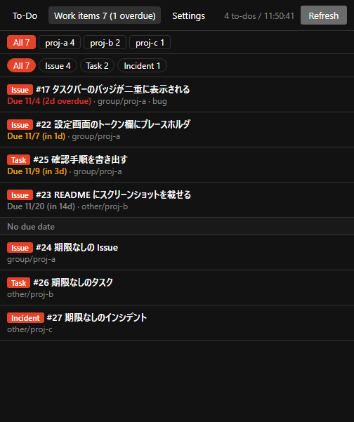

# Notice Me, Senpai! (NMS)

GitLab の通知メールが多すぎて困っていませんか？  
NMS は、GitLab の To-Do を Windows のタスクバーに件数バッジで表示するデスクトップアプリです。  
レビュー依頼・メンション・アサインなどを、タスクバーのバッジや通知領域（トレイ）で一目で確認できます。

※本アプリの開発には AI エージェントを使用しています。

> **English:** A tiny Windows tray app that shows your GitLab To-Do count as a taskbar badge.
> Works with GitLab.com and self-managed GitLab. Click an item to open it in your browser.
> The Work items tab lists the work items assigned to you (issues, incidents, test cases and tasks), nearest due date first, with undated items last.

<p>
  
  
</p>

<p align="center">右は UI を英語に切り替えた状態です。設定から日本語 / 英語を選べます（初回は OS の言語で自動決定）。</p>

## 目次 (Table of Contents)

- [できること](#できること-features)
- [動作環境](#動作環境-requirements)
- [使い方](#使い方-usage)
- [よくある質問](#よくある質問-faq)
- [セキュリティとプライバシー](#セキュリティとプライバシー-security-and-privacy)
- [開発](#開発-development)
- [ライセンス](#ライセンス-license)

## できること (Features)

- **タスクバーに件数バッジ:** 未完了の To-Do の件数を、タスクバーのアイコンに赤いバッジで表示します。通知領域（トレイ）のアイコンにも件数が出ます。
- **一覧でプレビュー:** 種別・タイトル・リポジトリ・作成者・経過時間を一覧で確認できます。クリックすると既定のブラウザで MR / Issue が開きます。
- **その場で完了:** 「完了」ボタンで、GitLab 上の To-Do を完了にできます。
- **絞り込み:** リポジトリ別のタブと、種別（アサイン、メンション、レビュー依頼など）のボタンで絞り込めます。
- **作業アイテムの確認:** 「作業アイテム」タブでは、自分にアサインされた作業アイテム（Issue、インシデント、テストケース、タスク）を期限が近い順に並べます。期限のないものは末尾の「期限なし」の下に出ます。リポジトリと種別で絞り込めて、最大 100 件まで表示します。タスクバーのバッジとトレイの件数には含めません。
- **期限の色分け:** アサインの To-Do と「作業アイテム」タブには期限を表示します。期限を過ぎたものは赤、3 日以内のものは橙です。
- **新着のデスクトップ通知**と、**Windows ログイン時の自動起動**に対応しています。
- **表示言語は日本語 / 英語**。設定タブで切り替えると、メニューや通知を含むアプリ全体の文言が変わります。

To-Do タブに表示する内容は、GitLab の画面右上にあるベルアイコン（To-Do リスト）と同じです。

## 動作環境 (Requirements)

- Windows 10 / 11（x64）
- GitLab.com、または Self-managed GitLab（REST API v4）

## 使い方 (Usage)

### 1. ダウンロード (Download)

[Releases](https://github.com/hyperdrums/Notice-Me-Senpai-/releases) から `NMS-x.y.z.exe` をダウンロードして、好きなフォルダに置いてください。インストールは不要で、ダブルクリックで起動します。

> 初回起動時に「Windows によって PC が保護されました」と表示された場合は、「詳細情報」→「実行」を選んでください。コード署名をしていないために表示されます。

ダウンロードしたファイルが公式のままか確認したい場合は、リリースに掲載してある SHA-256 のチェックサムと照合してください。手順は [セキュリティとプライバシー](#セキュリティとプライバシー-security-and-privacy) にあります。

### 2. アクセストークンを作る (Create an Access Token)

1. GitLab で `<GitLab の URL>/-/user_settings/personal_access_tokens` を開きます（右上のアバター →「設定」→「アクセストークン」）
2. 「新しいトークンを追加」を押し、スコープに `api` をチェックして作成します
   （「完了」ボタンを使わないなら `read_api` だけでも構いません）
3. 表示された `glpat-` で始まる文字列をコピーします。この画面を閉じると二度と表示されません

### 3. アプリに設定する (Configure the App)

初回起動時は「設定」タブが開きます。

| 項目 | 入力する値 |
|---|---|
| GitLab URL | 例: `https://gitlab.com`、`https://gitlab.example.com` |
| Personal Access Token | 手順 2 でコピーした `glpat-...` |
| 取得間隔 | 既定は 60 秒（最小 15 秒） |
| 表示言語 | 初回は OS の言語で自動決定します（日本語以外なら English）。切り替わるのはアプリの文言だけで、GitLab からの本文はそのままです |

「保存」を押すと取得が始まります。

自己署名証明書を使っている GitLab の場合は、「証明書エラーを無視」をオンにしてください。社内 CA の証明書が Windows の証明書ストアに入っていれば、この設定は不要です。

## よくある質問 (FAQ)

**× を押しても終了しません**

タスクバーのバッジはウィンドウに付くため、× は最小化になります。終了するには、通知領域の赤丸アイコンを右クリックして「終了」を選んでください。

**ブラウザで開いたのに件数が減りません**

GitLab の仕様です。To-Do は「見たかどうか」ではなく「対応したかどうか」で管理されます。MR の承認やマージ、Issue のクローズなどをすると自動で完了になります。読んだだけの通知は「完了」で片付けてください。

**メンションされていないコメントは通知されますか**

されません。To-Do が作られるのは、メンション、アサイン、レビュー依頼、CI の失敗などです。

**トークンはどこに保存されますか**

`%APPDATA%\notice-me-senpai\config.json` に、Windows の DPAPI で暗号化して保存されます。他のユーザーや他の PC では復号できません。トークンは設定した GitLab 以外には送信しません。詳しくは [セキュリティとプライバシー](#セキュリティとプライバシー-security-and-privacy) を見てください。

## セキュリティとプライバシー (Security and Privacy)

「このアプリが何をするのか」を、ソースを読まなくても確認できるように書いておきます。

### 通信先は設定した GitLab だけです (Only the GitLab You Configured)

アプリがネットワークにアクセスするのは、設定で入力した GitLab の URL に対してだけです。使う API は次の 3 つしかありません。

| API | 用途 |
|---|---|
| `GET /todos?state=pending` | 通知の一覧と件数 |
| `POST /todos/:id/mark_as_done` | 「完了」ボタン |
| `GET /issues?scope=assigned_to_me&state=opened` | 作業アイテムタブ（Issue、インシデント、テストケース、タスク） |

- **テレメトリ（利用状況の送信）はありません**
- **自動更新はありません**。更新は Releases を自分で確認します
- **外部の JS・CSS・フォント・画像は読み込みません**。画面はすべてアプリ本体の中に入っています
- GitLab API を呼ぶのはメインプロセスだけで、一覧を描画する画面（レンダラー）はネットワークにアクセスしません。

### トークンの取り扱い (About the Token)

アクセストークンは `PRIVATE-TOKEN` ヘッダーに入れて、設定した GitLab にだけ送信します。他のサーバーに送ることはありません。

保存は `%APPDATA%\notice-me-senpai\config.json` で、Windows の DPAPI を使って暗号化します（`tokenEnc` フィールド）。

- 同じ PC の同じ Windows ユーザーでしか復号できません
- 設定ファイルだけを別の PC や別のユーザープロファイルにコピーしても復号できません
- Windows のログインパスワードが漏れると復号されうる、という点は DPAPI 共通の前提として知っておいてください

### 証明書の検証について (Certificate Validation)

既定では HTTPS の証明書検証を正常に行います。「証明書エラーを無視」をオンにした場合でも、検証をスキップするのは**設定で入力したホストだけ**です。他のホストの証明書は通常どおり検証します。

### ダウンロードファイルの検証 (Verifying a Download)

このアプリはコード署名をしていないため、初回起動時に SmartScreen の警告が出ます。その代わりに、ダウンロードしたファイルが改ざんされていないことを確認できるように、各リリースへ SHA-256 のチェックサムを 2 箇所へ掲載しています。

- リリース資産の `SHA256SUMS.txt`
- リリース本文の末尾

確認するには、ダウンロードしたファイルと同じフォルダで次を実行します。

```
Get-FileHash .\NMS-0.2.0.exe -Algorithm SHA256
```

`Hash` の値が `SHA256SUMS.txt` のものと一致すれば、ファイルは公式のままです。

### 問題を発見したとき (Reporting a Problem)

脆弱性を見つけた場合は、[Issue](https://github.com/hyperdrums/Notice-Me-Senpai-/issues) を立てて教えてください。トークンなど個人情報は記載しないようお願いいたします。

## 開発 (Development)

```
npm install
node node_modules/electron/install.js   # Electron 本体のダウンロードが止まった場合のみ
npm start
```

- npm の allow-scripts 設定によっては、`npm install` で Electron 本体がダウンロードされません。その場合は 2 行目を実行してください。
- VS Code のターミナルでは環境変数 `ELECTRON_RUN_AS_NODE` が設定されていることがあります。残っていると Electron が素の Node として動くため、消してから起動してください。

### テスト (Tests)

```
npm test          # node --test（追加の依存ライブラリは使いません）
```

`src/lib.js` に「引数だけ結果が決まる純粋な関数」を集めて、`test/lib.test.js` で検証しています。
Electron の API や `document` を触るコードはここでテストできないので、`lib.js` に出すかどうかの目安にしてください。
`lib.js` は `main.js` から `require()`、`renderer.js` からは `<script>` で読むため、**読み込みは 1 回だけ**にしてください（2 回読むと宣言の重複でエラーになります）。

### GUI のテスト (GUI Tests with a Mock GitLab)

```
npm run test:gui    # アプリを実起動して画面を検証（スクショは dist/gui-test/ に出ます）
npm run mock        # モック GitLab だけ起動（http://127.0.0.1:8080 / glpat-mock-token）
```

本物の GitLab の代わりに `scripts/mock-gitlab.js` が API のふりをします。通知 4 件とアサインされた作業アイテム 7 件が入っていて、
期限切れ（赤）・3日以内（橙）・マイルストーン期限・期限なしまで再現するので、トークンを本物に切り替えずに画面を確認できます。

- `scripts/gui-test.js` が、Chrome DevTools Protocol（依存ゼロの自作クライアント）で画面を読み、
  件数・色分け・絞り込み・「完了」ボタン・新着のポーリング・作業アイテムタブ・取得失敗時の動きをチェックします
- `scripts/mock-config.js` が、テスト用の設定を本番と同じ DPAPI 暗号化で書き込みます
- 手動で見るだけなら `npm run mock` を別に起動して、設定に URL とトークンを入れるだけ。
  `curl -X POST http://127.0.0.1:8080/__push` で新着通知も再現できます。
  `curl "http://127.0.0.1:8080/__fail?target=issues&status=500"` で作業アイテムの取得失敗を再現できます（`status=0` で解除）

実行中はウィンドウが実際に映ります。`test:gui` は新着も送るので、最後にデスクトップ通知が出ます。

### ビルド (Build)

```
npm run dist                # dist/NMS-<version>.exe（portable 形式）を出力
node scripts/make-icon.js   # アイコン build/icon.ico を再生成（通常は不要）
```

### リリース (Release)

`package.json` の `version` を上げてコミットし、同じ番号のタグを push すると、GitHub Actions がビルドして Releases に `NMS-<version>.exe` と `SHA256SUMS.txt` を公開します。チェックサムはリリース本文の末尾にも追記されます。

```
npm version patch           # version を上げてコミットとタグ v0.2.1 を作成
git push --follow-tags
```

タグと `package.json` の `version` が一致しない場合、ビルドは失敗します。

### 仕組み (How It Works)

Electron 製です。画面は素の HTML/JS で、フレームワークは使っていません。

| ファイル | 役割 |
|---|---|
| `src/main.js` | ポーリング、GitLab API の呼び出し、タスクバーのバッジとトレイ、設定の保存 |
| `src/lib.js` | 純粋な計算と翻訳テーブル（URL 組み立て、設定のマージ、期限の色分け、`tr()`）。`npm test` で検証する |
| `src/preload.js` | 画面側に公開する IPC |
| `src/index.html` / `src/renderer.js` | To-Do・作業アイテム・設定の画面、バッジ画像の描画 |
| `scripts/make-icon.js` | アイコンの生成（外部ライブラリなし） |

使っている GitLab API は 3 つだけです（To-Do と作業アイテムは、それぞれ最大 100 件まで取得します）。一覧と用途は [セキュリティとプライバシー](#セキュリティとプライバシー-security-and-privacy) に書いてあります。

軽量化のため、GPU 処理とネットワーク処理を別プロセスにせず、メインプロセスに統合しています。

## ライセンス (License)

[MIT](LICENSE)
