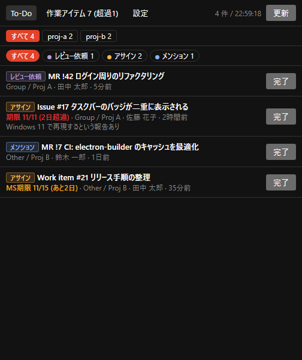
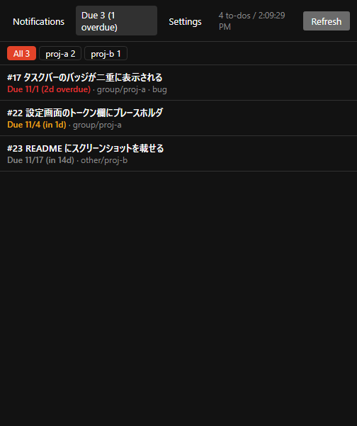

# Notice Me, Senpai! (NMS)

GitLab の通知メールが多すぎて困っていませんか？  
NMS は、GitLab の To-Do を Windows のタスクバーに件数バッジで表示するデスクトップアプリです。  
レビュー依頼・メンション・アサインなどを、タスクバーのバッジや通知領域（トレイ）で一目で確認できます。

※本アプリの開発には AI エージェントを使用しています。

> **English:** A tiny Windows tray app that shows your GitLab To-Do count as a taskbar badge.
> Works with GitLab.com and self-managed GitLab. Click an item to open it in your browser.

<p>
  
  
</p>

## できること

- **タスクバーに件数バッジ:** 未完了の To-Do の件数を、タスクバーのアイコンに赤いバッジで表示します。通知領域（トレイ）のアイコンにも件数が出ます。
- **一覧でプレビュー:** 種別・タイトル・リポジトリ・作成者・経過時間を一覧で確認できます。クリックすると既定のブラウザで MR / Issue が開きます。
- **その場で完了:** 「完了」ボタンで、GitLab 上の To-Do を完了にできます。
- **絞り込み:** リポジトリ別のタブと、種別（アサイン、メンション、レビュー依頼など）のボタンで絞り込めます。
- **期限の確認:** アサインの通知には期限を表示します。「期限」タブでは、自分にアサインされた Issue を期限が近い順に並べます。期限を過ぎたものは赤、3 日以内のものは橙です。
- **新着のデスクトップ通知**と、**Windows ログイン時の自動起動**に対応しています。

表示する内容は、GitLab の画面右上にあるベルアイコン（To-Do リスト）と同じです。

## 動作環境

- Windows 10 / 11（x64）
- GitLab.com、または Self-managed GitLab（REST API v4）

## 使い方

### 1. ダウンロード

[Releases](https://github.com/hyperdrums/Notice-Me-Senpai-/releases) から `NMS-x.y.z.exe` をダウンロードして、好きなフォルダに置いてください。インストールは不要で、ダブルクリックで起動します。

> 初回起動時に「Windows によって PC が保護されました」と表示された場合は、「詳細情報」→「実行」を選んでください。コード署名をしていないために表示されます。

### 2. アクセストークンを作る

1. GitLab で `<GitLab の URL>/-/user_settings/personal_access_tokens` を開きます（右上のアバター →「設定」→「アクセストークン」）
2. 「新しいトークンを追加」を押し、スコープに `api` をチェックして作成します
   （「完了」ボタンを使わないなら `read_api` だけでも構いません）
3. 表示された `glpat-` で始まる文字列をコピーします。この画面を閉じると二度と表示されません

### 3. アプリに設定する

初回起動時は「設定」タブが開きます。

| 項目 | 入力する値 |
|---|---|
| GitLab URL | 例: `https://gitlab.com`、`https://gitlab.example.com` |
| Personal Access Token | 手順 2 でコピーした `glpat-...` |
| 取得間隔 | 既定は 60 秒（最小 15 秒） |

「保存」を押すと取得が始まります。

自己署名証明書を使っている GitLab の場合は、「証明書エラーを無視」をオンにしてください。社内 CA の証明書が Windows の証明書ストアに入っていれば、この設定は不要です。

## よくある質問

**× を押しても終了しません**

タスクバーのバッジはウィンドウに付くため、× は最小化になります。終了するには、通知領域の赤丸アイコンを右クリックして「終了」を選んでください。

**ブラウザで開いたのに件数が減りません**

GitLab の仕様です。To-Do は「見たかどうか」ではなく「対応したかどうか」で管理されます。MR の承認やマージ、Issue のクローズなどをすると自動で完了になります。読んだだけの通知は「完了」で片付けてください。

**メンションされていないコメントは通知されますか**

されません。To-Do が作られるのは、メンション、アサイン、レビュー依頼、CI の失敗などです。

**トークンはどこに保存されますか**

`%APPDATA%\notice-me-senpai\config.json` に、Windows の DPAPI で暗号化して保存されます。他のユーザーや他の PC では復号できません。トークンは設定した GitLab 以外には送信しません。

## 開発

```
npm install
node node_modules/electron/install.js   # Electron 本体のダウンロードが止まった場合のみ
npm start
```

- npm の allow-scripts 設定によっては、`npm install` で Electron 本体がダウンロードされません。その場合は 2 行目を実行してください。
- VS Code のターミナルでは環境変数 `ELECTRON_RUN_AS_NODE` が設定されていることがあります。残っていると Electron が素の Node として動くため、消してから起動してください。

### テスト

```
npm test          # node --test（追加の依存ライブラリは使いません）
```

`src/lib.js` に「引数だけ結果が決まる純粋な関数」を集めて、`test/lib.test.js` で検証しています。
Electron の API や `document` を触るコードはここでテストできないので、`lib.js` に出すかどうかの目安にしてください。
`lib.js` は `main.js` から `require()`、`renderer.js` からは `<script>` で読むため、**読み込みは 1 回だけ**にしてください（2 回読むと宣言の重複でエラーになります）。

### ビルド

```
npm run dist                # dist/NMS-<version>.exe（portable 形式）を出力
node scripts/make-icon.js   # アイコン build/icon.ico を再生成（通常は不要）
```

### リリース

`package.json` の `version` を上げてコミットし、同じ番号のタグを push すると、GitHub Actions がビルドして Releases に `NMS-<version>.exe` を公開します。

```
npm version patch           # version を上げてコミットとタグ v0.1.1 を作成
git push --follow-tags
```

タグと `package.json` の `version` が一致しない場合、ビルドは失敗します。

### 仕組み

Electron 製です。画面は素の HTML/JS で、フレームワークは使っていません。

| ファイル | 役割 |
|---|---|
| `src/main.js` | ポーリング、GitLab API の呼び出し、タスクバーのバッジとトレイ、設定の保存 |
| `src/lib.js` | 純粋な計算だけ（URL 組み立て、設定のマージ、期限の色分け）。`npm test` で検証する |
| `src/preload.js` | 画面側に公開する IPC |
| `src/index.html` / `src/renderer.js` | 一覧・期限・設定の画面、バッジ画像の描画 |
| `scripts/make-icon.js` | アイコンの生成（外部ライブラリなし） |

使っている GitLab API は次の 3 つです。To-Do と Issue は、それぞれ最大 100 件まで取得します。

| API | 用途 |
|---|---|
| `GET /todos?state=pending` | 通知の一覧と件数 |
| `POST /todos/:id/mark_as_done` | 「完了」ボタン |
| `GET /issues?scope=assigned_to_me&state=opened` | 期限タブ |

軽量化のため、GPU 処理とネットワーク処理を別プロセスにせず、メインプロセスに統合しています。

## ライセンス

[MIT](LICENSE)
